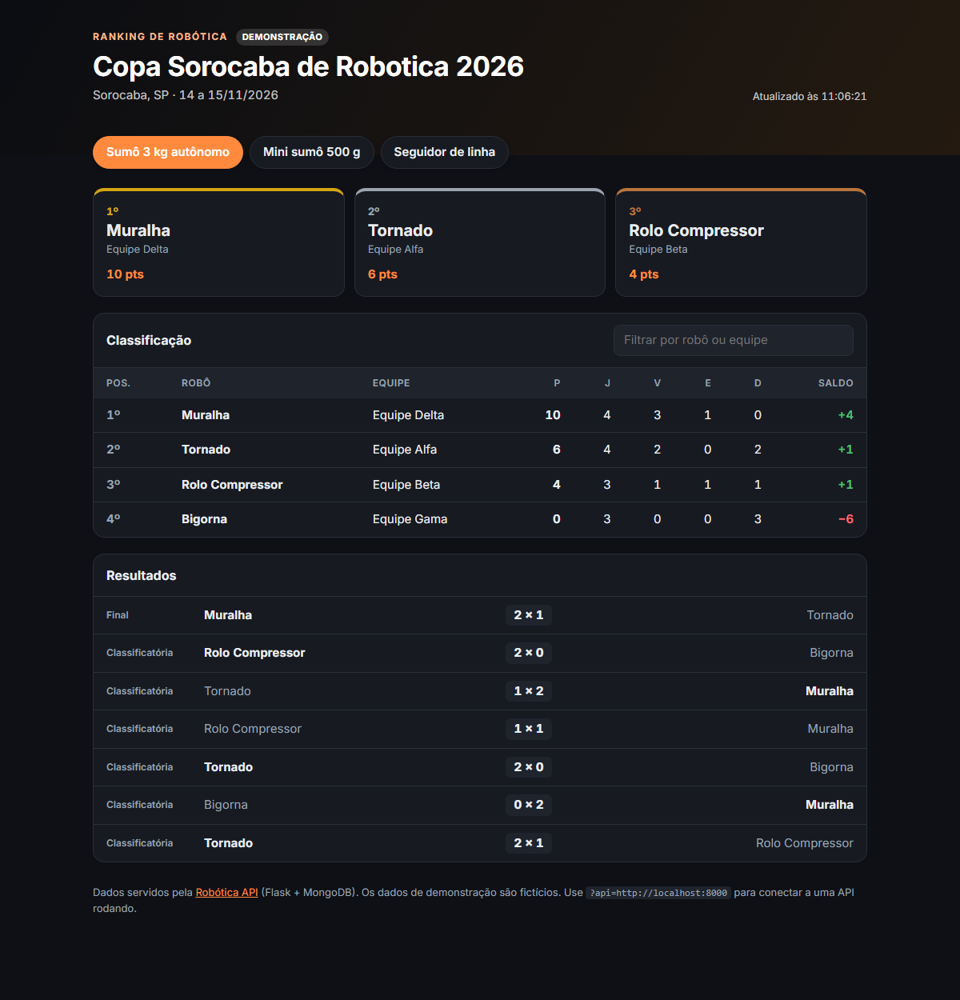

# Ranking de Robótica (painel web)


Painel web que mostra a **classificação de competições de robótica**: pódio, tabela completa e resultados das partidas. Ele consome a [Robótica API](https://github.com/Kauan-V-Marques/robotica-api-flask) (Flask + MongoDB) e também funciona sozinho, com dados de demonstração.

**Demonstração:** https://kauan-v-marques.github.io/ranking-robotica-web/



## Funcionalidades

- Abas por categoria, com dois formatos:
  - **sumô:** pontos, jogos, vitórias, empates, derrotas e saldo de rounds
  - **seguidor de linha:** melhor volta, média, voltas válidas e diferença para o líder
- Pódio com os três primeiros (empatados dividem a posição)
- Filtro por robô ou equipe que ignora acentos e maiúsculas ("faisca" encontra "Faísca")
- Lista de resultados com destaque para o vencedor
- Atualização automática a cada 15 s quando conectado à API
- Link compartilhável por categoria (`?categoria=seguidor_de_linha`)
- Tema claro e escuro automático, layout responsivo e tabela acessível
- Todo texto vindo da API é escapado antes de entrar no HTML

## Como funciona

HTML, CSS e JavaScript puro em módulos ES, sem framework e sem etapa de build.

```text
index.html
css/style.css     visual, temas claro/escuro e versão mobile
js/source.js      de onde vêm os dados: API real ou arquivos de demonstração
js/ranking.js     funções puras: formatação de tempo, diferença para o líder, filtro
js/app.js         monta a tela e trata os eventos
data/demo/        respostas reais da API, salvas como JSON
tests/            testes com o test runner nativo do Node
```

## Usando com a API

Suba a [Robótica API](https://github.com/Kauan-V-Marques/robotica-api-flask) e passe o endereço dela na URL:

```text
https://kauan-v-marques.github.io/ranking-robotica-web/?api=http://localhost:8000
```

Com a API conectada, o selo muda para **Ao vivo** e aparece a opção de atualização automática.

## Rodando localmente

Como o projeto usa módulos ES, ele precisa ser aberto por um servidor (não funciona com `file://`):

```bash
python -m http.server 8080
# ou
npm start
```

## Testes

```bash
npm test
```

Os testes usam o `node:test` e cobrem a formatação de voltas (`17,620 s` e `1:02,345`), a diferença para o líder, o saldo com sinal, o filtro sem acentos, o vencedor da partida, o intervalo de datas e o escape de HTML. O GitHub Actions roda os testes e valida os dados de demonstração a cada push.

---

<details>
<summary>English</summary>

### Robotics Ranking Dashboard

A vanilla **HTML/CSS/JavaScript** dashboard (ES modules, no framework, no build step) showing robotics competition standings: podium, full table and match results. It consumes the [Robotics API](https://github.com/Kauan-V-Marques/robotica-api-flask) (`?api=http://localhost:8000`) or falls back to bundled demo data.

Sumo and line-follower formats, accent-insensitive filter, auto-refresh, shareable category links, light/dark themes, responsive layout, HTML escaping of API data and unit tests with Node's built-in test runner.

Live demo: https://kauan-v-marques.github.io/ranking-robotica-web/

</details>
